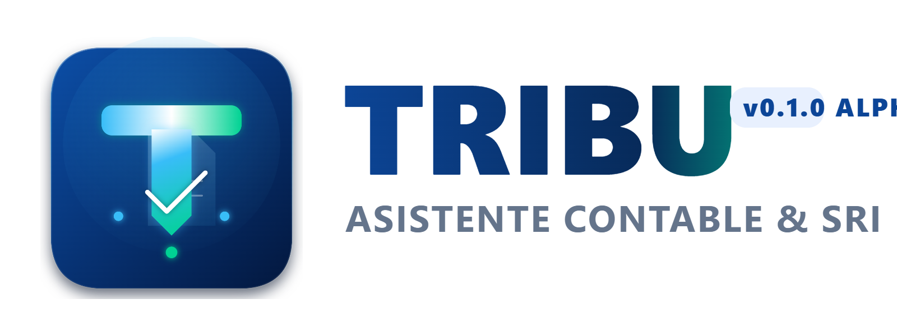

<p align="center">
  
</p>

<p align="center">
  <strong>El asistente de escritorio inteligente para contadores y contribuyentes del SRI Ecuador.</strong><br>
  Automatiza descargas masivas de facturas, reclamos de IVA y generación de anexos tributarios en segundos.
</p>

<p align="center">
  <a href="https://github.com/JeanAxon/TRIBU/releases/download/v0.1.1-alpha/TRIBU-Setup-0.1.1-alpha.exe">
    
  </a>
  <a href="https://github.com/JeanAxon/TRIBU/releases/download/v0.1.1-alpha/TRIBU-0.1.1-alpha-mac-universal.dmg">
    
  </a>
  
  
</p>

---

## ⚡ ¿Qué hace TRIBU por ti?

- **📥 Descarga Masiva de Facturas (XML y PDF):**
  Descarga cientos de comprobantes electrónicos del portal SRI en segundos, organizándolos automáticamente en carpetas por cliente, tipo (Ventas/Compras), año y mes.

- **📋 Reclamo Automático de IVA (Discapacidad y Tercera Edad):**
  Rellena en 1 clic la tabla oficial de devolución del SRI: calcula montos de IVA, marca casillas e infiere inteligentemente el tipo de gasto (alimentación, salud, educación, vestimenta, vivienda) según el comercio.

- **📊 Anexo Transaccional Simplificado (ATS) & Excel:**
  Genera el archivo XML oficial del ATS listo para validar en el DIMM / SRI y exporta reportes detallados en CSV compatibles con Microsoft Excel.

- **🔒 Sesiones Aisladas y Privacidad Total:**
  Cada RUC cuenta con su propia sesión independiente de navegación. Tus contraseñas y archivos se guardan **únicamente en tu equipo** con cifrado local AES-256.

---

## 🚀 Instalación Rápida

### 🪟 Windows (10 / 11)
1. **Descarga el instalador:** Haz clic en el botón azul de Windows o descárgalo desde **[GitHub Releases](https://github.com/JeanAxon/TRIBU/releases/latest)**.
2. **Ejecuta el archivo:** Sigue el asistente de instalación.
3. **¡Listo!** Abre TRIBU desde el acceso directo de tu Escritorio o Menú Inicio.

### 🍏 macOS (Big Sur 11.0 o superior)
1. **Descarga el archivo `.dmg`:** Haz clic en el botón negro de macOS (se descarga el instalador universal compatible con Intel y Apple Silicon).
2. **Instala:** Abre el archivo `.dmg` y arrastra el icono de **TRIBU** a la carpeta **Aplicaciones**.
3. **Primer inicio:** Al ser versión Alpha, haz **Clic derecho (o Control + Clic)** sobre la app y selecciona **'Abrir'** para autorizar el primer uso en macOS Gatekeeper.

---

## 💻 Para Desarrolladores

Si deseas compilar o probar el código fuente:

```powershell
# Instalar dependencias
npm install

# Iniciar en modo desarrollo
npm start

# Ejecutar batería de pruebas unitarias y DOM
npm test

# Compilar instalador oficial de Windows
npm run dist
```
